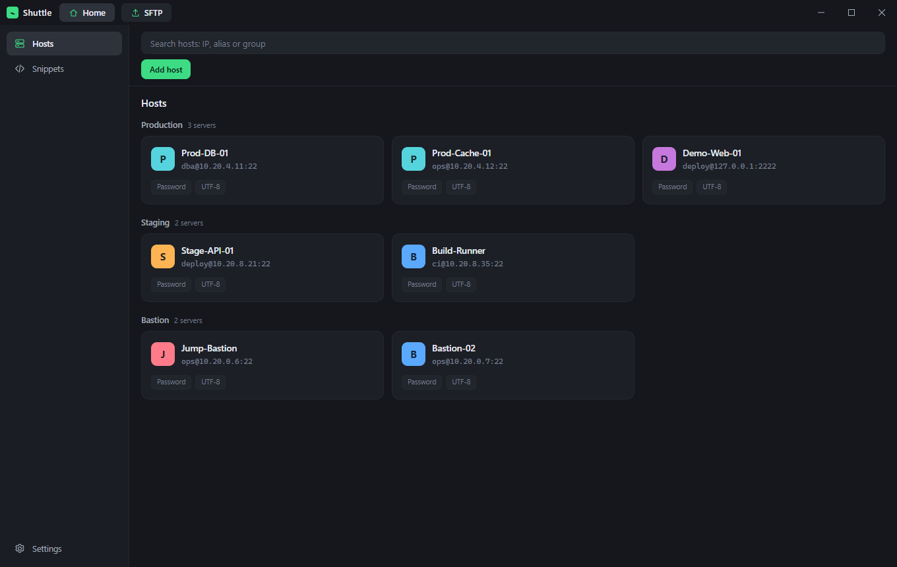
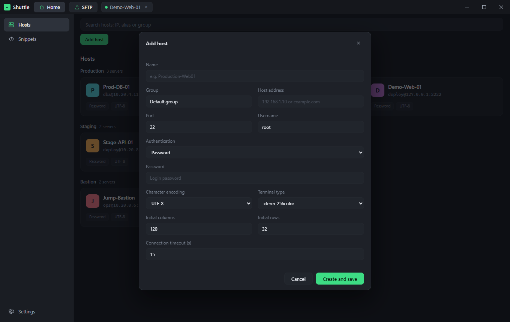
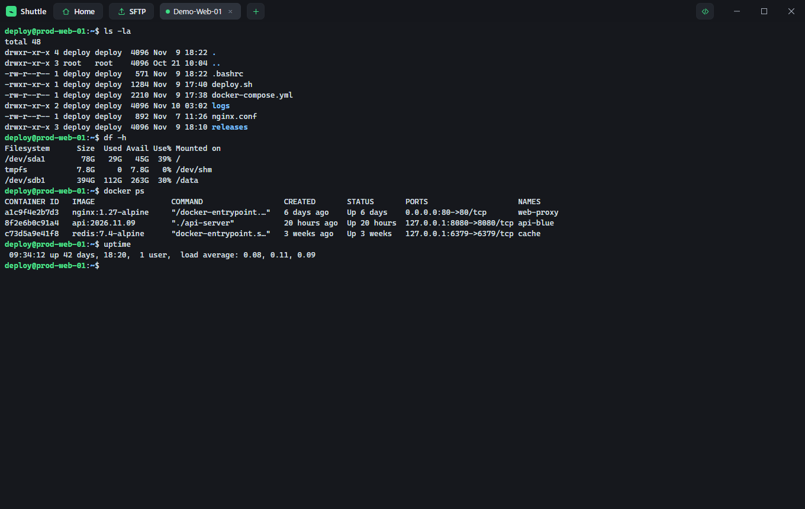
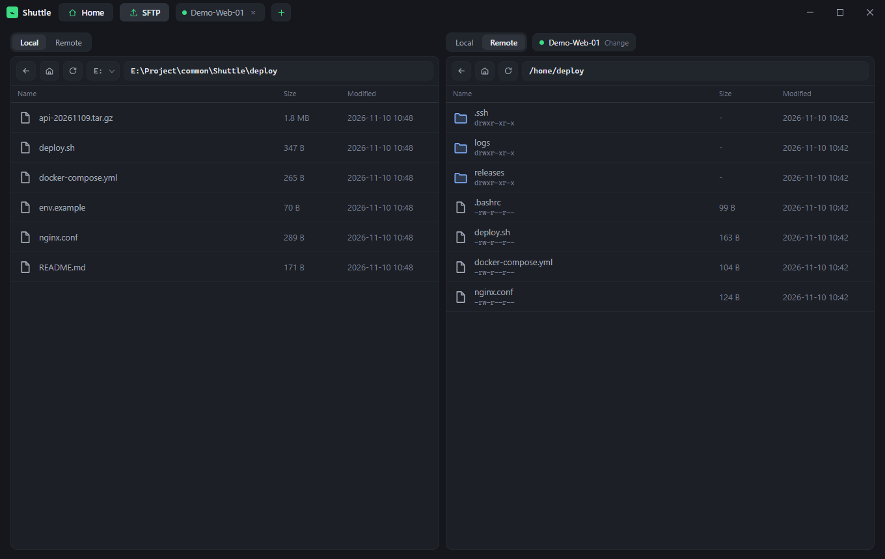
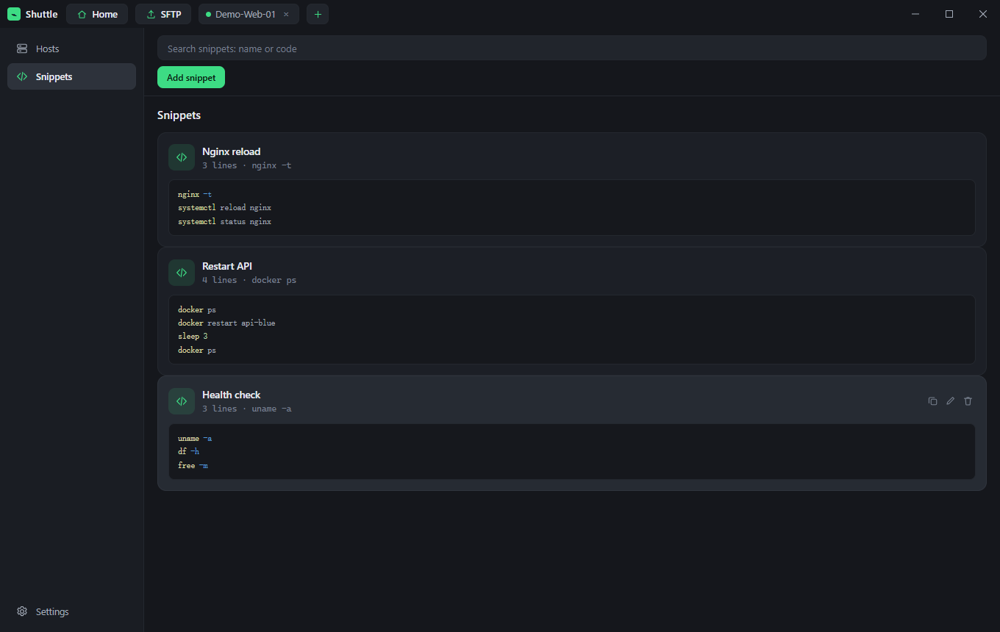

# Shuttle

Un gestor SSH de escritorio para trabajar con muchos servidores a la vez, creado con [Wails v3](https://v3.wails.io/), Go y Vue 3.

[English](README.md) | [简体中文](README.zh-CN.md) | Español



## Funciones

### Perfiles de host agrupados

Guarda cada conexión (host, puerto, usuario, contraseña o clave privada, tipo de terminal, codificación, tiempo de espera) en una lista con búsqueda. Organízalos por entorno —Producción, Staging, Bastión— y haz doble clic en una tarjeta para conectar.



### Terminales multisesión

Abre tantas sesiones SSH como necesites. Cada sesión es una pestaña en la barra superior y sigue activa mientras trabajas en otra parte de la aplicación. Renderizado con xterm.js, tamaño de fuente ajustable y vista en cuadrícula para vigilar varios servidores a la vez.



### Espacio de trabajo SFTP

Administrador de archivos de dos paneles: cada panel explora de forma independiente el disco local o un servidor remoto. Arrastra archivos, descarga, sube o transfiere directamente de un servidor a otro con progreso en vivo.



### Fragmentos de código

Guarda secuencias de comandos de uso frecuente y cópialas o ejecútalas en la terminal activa desde el panel lateral.



### Todo lo demás

- **Importar / exportar cifrado** — copia de seguridad y restauración de toda la lista de hosts en un archivo protegido con contraseña.
- **Almacenamiento local** — los perfiles viven en una base de datos SQLite junto al ejecutable y los secretos se cifran con una clave de la instalación.
- **Temas y tipografía** — apariencia clara / oscura y tamaño de fuente de terminal ajustable.
- **Interfaz trilingüe** — English, chino simplificado y español, con cambio inmediato desde «Ajustes → Idioma».

## Requisitos

- Go 1.26+
- Node.js 18+ y npm
- La [CLI de Wails v3](https://v3.wails.io/getting-started/installation/) y [Task](https://taskfile.dev/)

## Desarrollo

```bash
# instalar dependencias del frontend
cd frontend && npm install && cd ..

# ejecutar en modo desarrollo con recarga en caliente
wails3 dev
```

## Compilación

```bash
wails3 build
```

El ejecutable se genera en `bin/`. En tiempo de ejecución Shuttle guarda sus datos junto a ese ejecutable:

| Archivo | Función |
| --- | --- |
| `hosts.db` | Base de datos SQLite con los perfiles y las credenciales cifradas |
| `master.key` | Clave de la instalación para cifrar contraseñas y frases de clave |

Para mover la configuración a otra máquina, copia el ejecutable junto con estos dos archivos.

## Estructura del proyecto

```
.
├── main.go              # punto de entrada y configuración de la ventana
├── sshservice.go        # servicio Wails expuesto al frontend
├── internal/sshcore/    # sesiones SSH, SFTP, almacenamiento y cifrado
├── frontend/src/        # aplicación Vue 3
│   ├── App.vue          # ventana principal, pestañas, host, ajustes
│   ├── components/      # paneles de terminal, SFTP y diálogos
│   └── locales/         # catálogos de mensajes en / zh-CN / es
└── build/               # recursos de compilación por plataforma
```

## Internacionalización

Todos los textos de la interfaz están en `frontend/src/locales`. En el primer arranque se detecta el idioma del navegador y luego se guarda en `localStorage` con la clave `shuttle.locale`. Para añadir un idioma:

1. Copia `en.ts` como `frontend/src/locales/<locale>.ts` y traduce.
2. Regístralo en `frontend/src/i18n.ts` (`messages` y `localeOptions`).

## Contribuir

Las issues y pull requests son bienvenidas. Añade los textos nuevos a los catálogos de idiomas en lugar de escribirlos directamente en los componentes.
