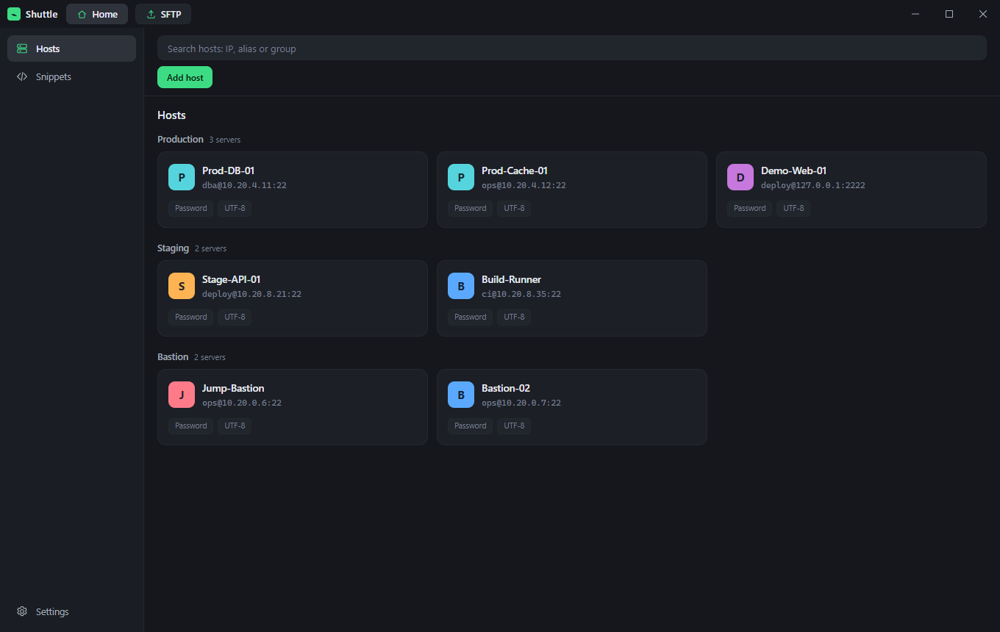
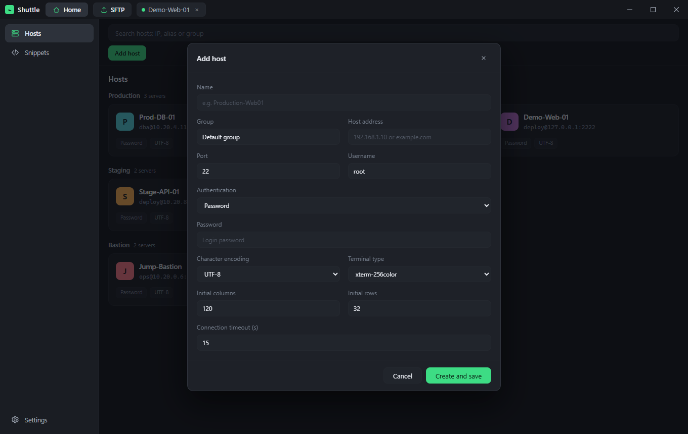
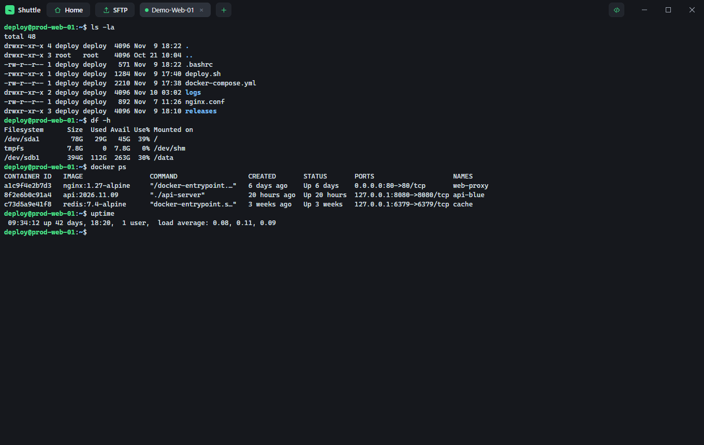
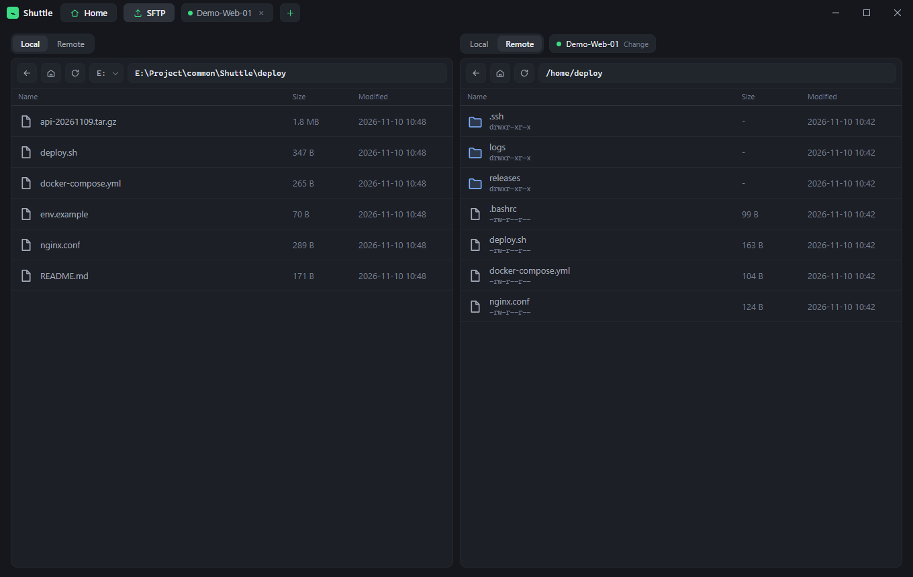
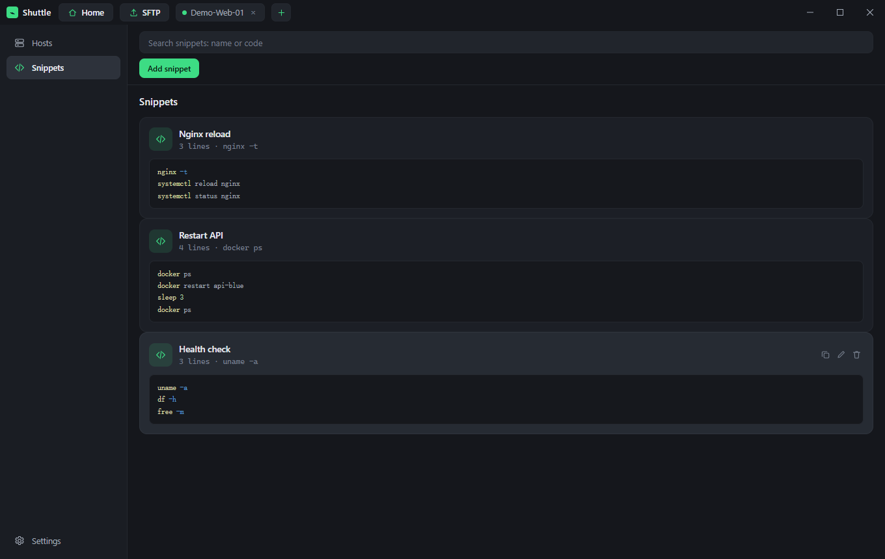

# Shuttle

A desktop SSH manager for people who work with many servers at once — built with [Wails v3](https://v3.wails.io/), Go and Vue 3.

English | [简体中文](README.zh-CN.md) | [Español](README.es.md)



## Features

### Host profiles, grouped

Keep every connection (host, port, user, password or private key, terminal type, encoding, timeout) in a searchable list. Group them by environment — Production, Staging, Bastion — and double-click a card to connect.



### Multi-session terminals

Open as many SSH sessions as you need. Each runtime is a tab in the top bar; sessions keep running while you work elsewhere in the app. xterm.js rendering, configurable font size, and a grid layout for watching several servers side by side.



### SFTP workspace

A two-pane file manager where each side independently browses the local disk or a remote server. Drag files across, download, upload, or transfer directly from one server to another with live progress.



### Snippets

Store frequently used command sequences, then copy them to the clipboard or run them in the focused terminal from the side drawer.



### Everything else

- **Encrypted import / export** — back up and restore the whole host list as a passphrase-protected file.
- **Local-first storage** — profiles live in a SQLite database next to the executable; secrets are encrypted with a per-install key.
- **Themes and typography** — light / dark appearance and adjustable terminal font size.
- **Trilingual UI** — English, Simplified Chinese and Spanish, switchable at runtime from Settings → Language.

## Requirements

- Go 1.26+
- Node.js 18+ and npm
- The [Wails v3 CLI](https://v3.wails.io/getting-started/installation/) and [Task](https://taskfile.dev/)

## Development

```bash
# install frontend dependencies
cd frontend && npm install && cd ..

# run in development mode with hot reload
wails3 dev
```

## Build

```bash
wails3 build
```

The executable is written to `bin/`. At runtime Shuttle keeps its data next to that executable:

| File | Purpose |
| --- | --- |
| `hosts.db` | SQLite database with host profiles and encrypted credentials |
| `master.key` | Per-install key used to encrypt stored passwords and passphrases |

Copy the executable together with these files to move your setup to another machine.

## Project layout

```
.
├── main.go              # application entry point and window setup
├── sshservice.go        # Wails service exposed to the frontend
├── internal/sshcore/    # SSH sessions, SFTP, host storage, crypto
├── frontend/src/        # Vue 3 app
│   ├── App.vue          # main window, tabs, host list, settings
│   ├── components/      # terminal pane, SFTP panes, dialogs
│   └── locales/         # en / zh-CN / es message catalogs
└── build/               # platform build assets and Taskfiles
```

## Internationalization

All UI strings live in `frontend/src/locales`. The active language is detected from the browser locale on first launch, then persisted in `localStorage` under `shuttle.locale`. Adding a language means:

1. Create `frontend/src/locales/<locale>.ts` by copying `en.ts`.
2. Register it in `frontend/src/i18n.ts` (`messages` and `localeOptions`).

## Contributing

Issues and pull requests are welcome. Please keep new UI text in the locale catalogs rather than hard-coding it in components.
