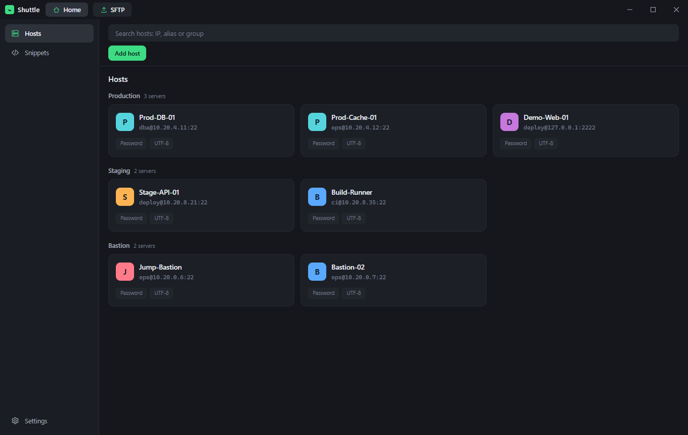
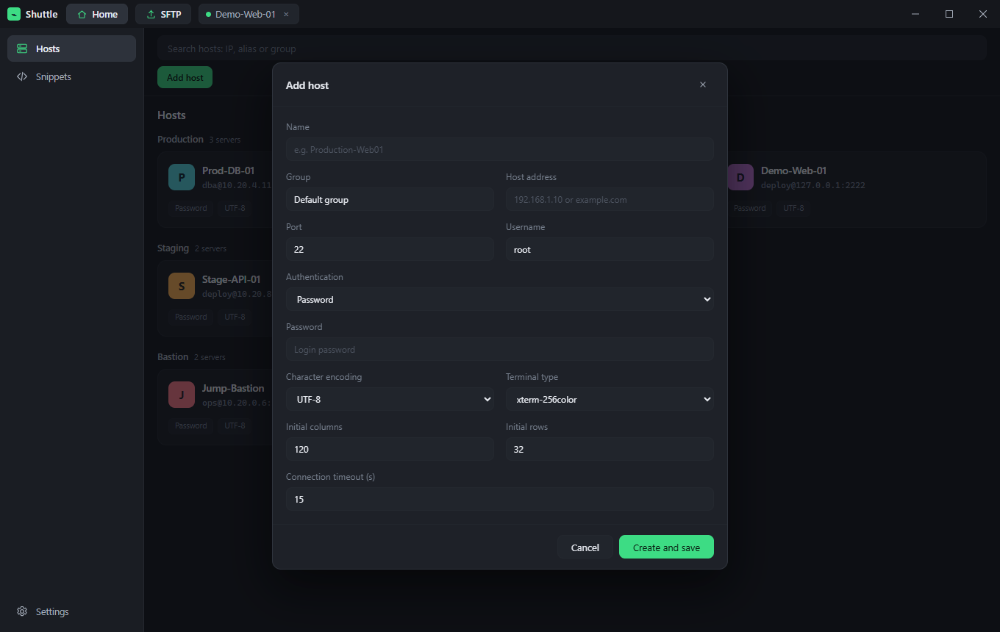
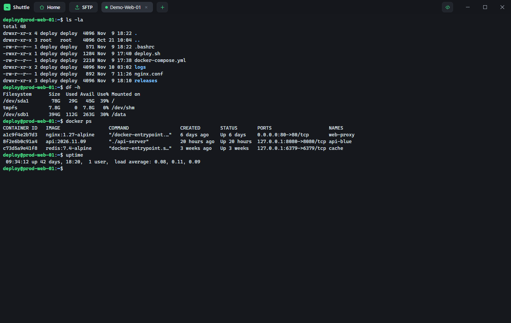
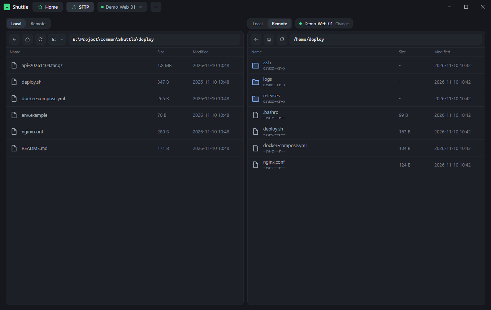
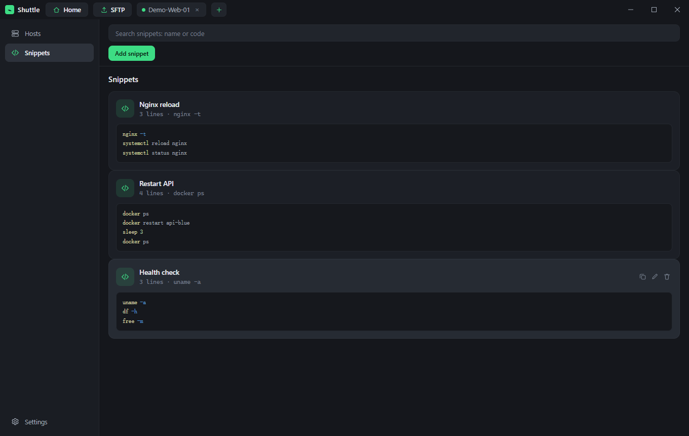

# Shuttle

一个面向多服务器场景的桌面 SSH 管理工具，基于 [Wails v3](https://v3.wails.io/)、Go 与 Vue 3 构建。

[English](README.md) | 简体中文 | [Español](README.es.md)



## 功能

### 主机档案与分组

按地址、端口、用户名、密码或私钥、终端类型、编码、超时等完整信息保存每台服务器，支持搜索与分组（如 Production / Staging / Bastion），双击卡片即可连接。



### 多会话终端

需要开多少个会话就开多少个，每个会话在顶部标签栏独立存在，切到其他页面时连接仍保持运行。基于 xterm.js 渲染，字号可调，也支持网格分屏同时观察多台服务器。



### SFTP 工作区

左右双栏文件管理，两侧都能各自选择本地磁盘或远程服务器；支持拖拽上传下载，也能在两个服务器之间直接传输并显示实时进度。



### 代码块

保存常用的命令序列，在侧边抽屉中一键复制或直接发送到当前终端执行。



### 其他

- **加密导入导出** — 以口令加密的文件备份与恢复整份主机列表。
- **本地优先存储** — 档案保存在可执行文件同目录的 SQLite 数据库中，密码使用本机密钥加密。
- **主题与字号** — 明暗两种外观，终端字号可调。
- **三语界面** — English / 简体中文 / Español，可在「设置 → 语言」中即时切换。

## 环境要求

- Go 1.26+
- Node.js 18+ 与 npm
- [Wails v3 CLI](https://v3.wails.io/getting-started/installation/) 与 [Task](https://taskfile.dev/)

## 开发

```bash
# 安装前端依赖
cd frontend && npm install && cd ..

# 以开发模式运行，支持热重载
wails3 dev
```

## 构建

```bash
wails3 build
```

产物会生成在 `bin/` 目录。运行时的数据就放在可执行文件旁边：

| 文件 | 用途 |
| --- | --- |
| `hosts.db` | SQLite 数据库，保存主机档案与加密后的凭据 |
| `master.key` | 本机安装密钥，用于加解密保存的密码与私钥口令 |

迁移到另一台机器时，把可执行文件与这两个文件一起复制过去即可。

## 项目结构

```
.
├── main.go              # 应用入口与窗口配置
├── sshservice.go        # 暴露给前端的 Wails 服务
├── internal/sshcore/    # SSH 会话、SFTP、档案存储与加密
├── frontend/src/        # Vue 3 前端
│   ├── App.vue          # 主界面、标签栏、主机列表、设置
│   ├── components/      # 终端面板、SFTP 面板、各类弹窗
│   └── locales/         # en / zh-CN / es 语言词条
└── build/               # 各平台构建资源与 Taskfile
```

## 多语言

界面文案全部位于 `frontend/src/locales`。首次启动时按浏览器语言自动选择，之后保存在 `localStorage` 的 `shuttle.locale` 中。新增语言只需两步：

1. 复制 `en.ts` 为 `frontend/src/locales/<locale>.ts` 并翻译。
2. 在 `frontend/src/i18n.ts` 的 `messages` 与 `localeOptions` 中注册。

## 参与贡献

欢迎提交 Issue 与 Pull Request。新增界面文案请写入语言词条，不要直接硬编码在组件里。
